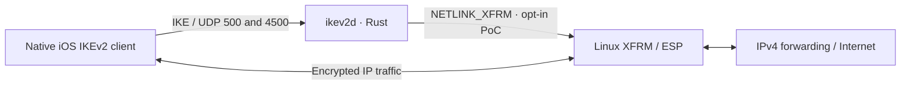

# Harbor VPN

**A custom Rust IKEv2/IPsec server for the built-in iPhone VPN client.**

Rust handles negotiation and authentication; Linux kernel XFRM handles ESP traffic. The project targets Ubuntu LTS and username/password authentication through EAP-MSCHAPv2, with a certificate-authenticated server.

[Quick start](#quick-start) · [Architecture](#architecture) · [Documentation](#documentation) · [Development](#development)

> [!IMPORTANT]
> **Experimental — ready for operator interoperability testing.** Authentication and an opt-in IPv4/XFRM proof of concept are implemented and locally tested. Native iPhone connectivity, Ubuntu VPS operation and Internet egress remain unverified. This is not a production-ready VPN.

## Current status

| Area | Implemented scope | Validation |
| --- | --- | --- |
| IKE_SA_INIT | Checked wire codec, suite negotiation, cookies, bounded state and UDP/NAT-T framing | Local tests and recorded fuzz evidence |
| IKE_AUTH | Server certificate/signature authentication, EAP-MSCHAPv2 and final AUTH verification | Local tests; native iOS acceptance pending |
| IPv4 VPN proof of concept | Initial CHILD_SA, address/DNS assignment, XFRM ESP, liveness replies, deletes and cleanup | Isolated Linux kernel packet round trip; iPhone/VPS acceptance pending |
| Internal control plane | Planned for Phase 2 | Not implemented |

The latest [PoC report](features/iphone_poc_report.md) records the checks performed and remaining acceptance gates. Earlier [Milestone 2](features/milestone_2_report.md) and [Milestone 3](features/milestone_3_report.md) reports describe their historical scopes.

**Current limits:** IPv4 only; no IPv6 traffic protection, automatic rekey, MOBIKE, active responder liveness probes or negotiated IKE fragmentation. Sessions have a bounded lifetime. See the [PoC runbook](docs/iphone-poc.md) before testing on a real host.

## Quick start

### Prerequisites

- Rust **1.97+**, edition 2024, with Cargo, rustfmt and Clippy.
- A C compiler, `pkg-config` and **OpenSSL 3.x** development headers/libraries. OpenSSL is linked from the host rather than vendored.
- Linux for the XFRM proof of concept; Ubuntu LTS is the deployment target.

On Ubuntu, install the build dependencies:

```sh
sudo apt-get update
sudo apt-get install build-essential pkg-config libssl-dev ca-certificates
```

### Build and validate configuration

From the repository root:

```sh
cd src
cargo build --workspace --locked
cargo run --locked -p ikev2d -- config/milestone-1.toml
```

The second command validates the configuration and exits. **The daemon does not listen by default.** All Cargo commands below also run from `src/`.

### Try the initial-exchange lab

```sh
cargo run --locked -p ikev2d -- --serve config/milestone-2-lab.toml
```

This explicitly starts an **unauthenticated IKE_SA_INIT-only** listener on loopback UDP ports `15000` and `14500`. It cannot establish a VPN connection. Stop it with **Ctrl-C**. See [initial-exchange behavior](docs/protocol/ike-sa-init.md) for details.

### Test authentication or the IPv4 VPN

These modes require protected credentials and additional operator preparation:

| Configuration | Purpose | Setup guide |
| --- | --- | --- |
| [`milestone-3-lab.toml`](src/config/milestone-3-lab.toml) | Authentication-only lab; no CHILD_SA or traffic routing | [IKE_AUTH and credential provisioning](docs/protocol/ike-auth.md) |
| [`iphone-poc.toml`](src/config/iphone-poc.toml) | Opt-in IPv4/XFRM VPN proof of concept | [iPhone PoC runbook](docs/iphone-poc.md) |

The PoC guide covers certificates, systemd credentials, capabilities, scoped firewall/NAT rules, the iPhone profile and cleanup. Example configurations require review for the target host; they are not a deployment installer.

## Architecture



Host routing, forwarding and firewall/NAT setup follow the operator runbook. The daemon does not configure them automatically.

- **Authentication:** EAP-MSCHAPv2 username/password; server identity through X.509 IKEv2 AUTH. No client certificates or device-registration model.
- **Cryptography:** OpenSSL-backed IKE AES-256-GCM-16, PRF-HMAC-SHA-256 and P-256/ECP19; ESP AES-256-GCM in the PoC. No custom cryptographic primitives.
- **Process boundaries:** IKEv2 has its own daemon. The shared internal control plane is reserved for Phase 2.

### Workspace map

All Rust application code, configurations, tests and fuzz tooling live under [`src/`](src/).

| Component | Responsibility |
| --- | --- |
| [`ikev2d`](src/bins/ikev2d/) | Configuration validation and explicitly enabled listener |
| [`ikev2-wire`](src/crates/ikev2-wire/) | Bounded packet parsing and serialization |
| [`ikev2-core`](src/crates/ikev2-core/) | Negotiation, authentication state and CHILD_SA lifecycle |
| [`ikev2-crypto`](src/crates/ikev2-crypto/) | OpenSSL integration, key derivation and protected messages |
| [`ikev2-transport`](src/crates/ikev2-transport/) | Bounded IPv4 UDP and NAT-T transport |
| [`vpn-auth`](src/crates/vpn-auth/) | EAP method, encrypted verifier store and credential loading |
| [`xfrm-linux`](src/crates/xfrm-linux/) | Linux netlink/XFRM installation and owned-resource cleanup |
| [`vpn-config`](src/crates/vpn-config/) | Typed TOML configuration and resource limits |
| [`vpn-observability`](src/crates/vpn-observability/) | Structured metadata logging |
| [`fuzz`](src/fuzz/) | Separate nightly libFuzzer workspace and campaign tooling |

## Documentation

| Start here | Contents |
| --- | --- |
| [Product requirements](docs/PRD.md) | Goals, client experience and phased roadmap |
| [Technical design](docs/TDD.md) | Architecture, trust boundaries and implementation milestones |
| [Architecture decisions](docs/ADR-001.md) · [ADR-002](docs/ADR-002.md) · [ADR-003](docs/ADR-003.md) | Design constraints and later scoped decisions |
| [Decision register](docs/decision-register.md) | Decision status and unresolved gates |
| [Wire codec](docs/protocol/wire-codec.md) | Packet handling and bounds |
| [IKE_SA_INIT](docs/protocol/ike-sa-init.md) | Initial exchange and lab operation |
| [IKE_AUTH](docs/protocol/ike-auth.md) | Authentication sequence and credential custody |
| [iPhone PoC runbook](docs/iphone-poc.md) | Operator preparation, testing and rollback |
| [Fuzzing guide](src/fuzz/README.md) | Targets, sanitizer runs and evidence |

## Development

Run the standard checks from `src/`:

```sh
cargo fmt --all -- --check
cargo clippy --workspace --all-targets --locked -- -D warnings
cargo test --workspace --locked
```

Ordinary workspace tests do not run the privileged namespace-only kernel test. Follow the [PoC report](features/iphone_poc_report.md) and [fuzzing guide](src/fuzz/README.md) for specialized verification and its limits.

Before contributing, read [AGENTS.md](AGENTS.md) and the linked specifications. Keep changes within the approved milestone, validate untrusted inputs and test parsers, serializers and state transitions. Pending architectural decisions require resolution before implementation; the next milestone does not start automatically.

Keep passwords, verifier material, private keys, production credentials and sensitive packet captures outside Git. When reporting a problem, include the source revision, platform/toolchain versions, reproduction steps and sanitized diagnostics.
